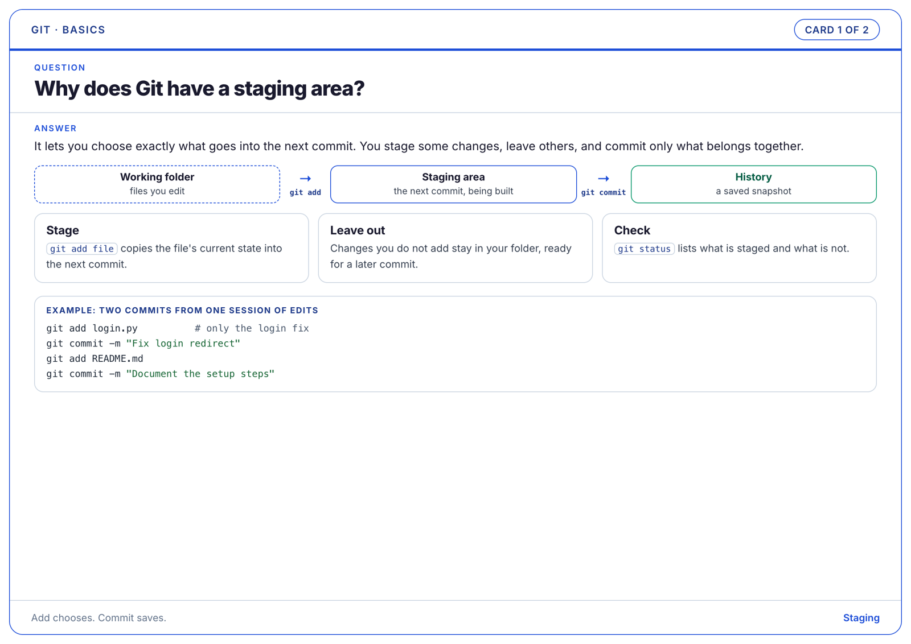
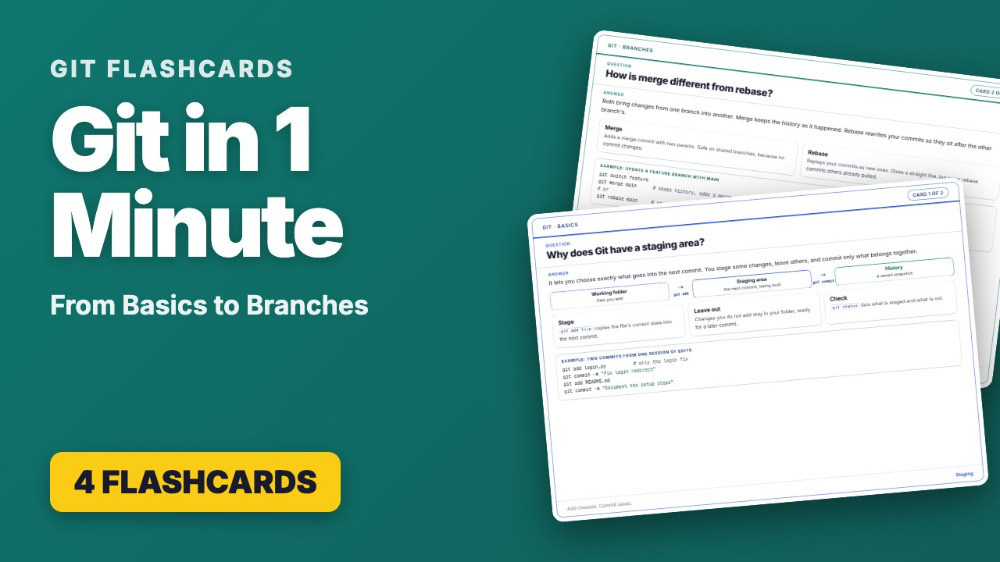

# Claude Skills

Skills for [Claude](https://claude.com), in Claude Code and the Claude app. A skill is a folder of instructions and scripts that Claude loads when a task calls for it, so it can do that task the same careful way every time.

| Skill | What it does |
| --- | --- |
| [flashcard-deck](flashcard-deck/) | Turns any subject, or material you already have (lecture PDFs, slides, notes, a repo, existing Anki cards), into print-friendly study flashcards grouped by topic, with PDFs, and optionally YouTube videos and thumbnails. It starts by asking what you need. |

## Install a skill

**Claude Code** (works in every project on your machine):

```bash
git clone https://github.com/Walid-Ahmed/claude-skills.git
mkdir -p ~/.claude/skills
cp -r claude-skills/flashcard-deck ~/.claude/skills/
```

Start a new Claude Code session afterwards. The skill is then listed, and you can call it by name (`/flashcard-deck`) or just ask for what it does.

**Claude app**: download [`dist/flashcard-deck.skill`](dist/flashcard-deck.skill) and open it in Claude. If your account or organization allows custom skills, a **Save skill** button installs it.

To update a skill, pull the repo and copy the folder again.

---

## flashcard-deck

Make a deck of question-and-answer flashcards that teach the concept first, print cleanly on A4, and can become YouTube videos.

<p align="center"></p>

### What you get

- **Cards**: one A4 landscape image per card (2400 x 1698 px). The question is at the top, the answer below it: a one-line answer, then boxes, steps, tables, small diagrams, and a labelled code example. White paper with coloured outlines, so the cards are cheap to print.
- **Topics**: cards grouped into topic folders, each with its own colour, numbered "Card 2 of 5".
- **Print**: one PDF per topic and one with every card, one card per A4 page.
- **Index**: a README listing every question, and where each card comes from in your material, if you want that.
- **Videos** (optional), 1920 x 1080 with chapter descriptions ready for YouTube, in three styles:
  - question with a countdown, then the answer
  - a questions-only quiz
  - a quick review of the full cards
- **Thumbnails** (optional): a YouTube thumbnail per video.

<p align="center"></p>

### Example

**[FastAPI Flashcards: from Routes to JWT Authentication](https://www.youtube.com/watch?v=dwvtkUu2rbM&t=4s)** is a FastAPI flashcard deck in this style, made into a YouTube video.

<p align="center"><a href="https://www.youtube.com/watch?v=dwvtkUu2rbM&t=4s"></a></p>

### How to use it

Ask in your own words, in any project:

- "make flashcards about Docker basics"
- "turn my lecture slides in `slides/week3.pdf` into flashcards, with page numbers"
- "I have an Anki export of my networking cards, make them printable and grouped by topic"
- "make study cards for this repo, then a quiz video"

Claude then:

1. **Asks what you need**, with clickable choices:
   - the source of the cards
   - how closely to follow your material
   - who the cards are for
   - the maximum number of cards (the build stops if the deck grows past it)
   - which outputs you want
2. **Proposes a plan**: the topics, and the question on each card. When working from your material, it also shows which pages or sections each topic covers. Nothing is written until you approve.
3. **Builds the first topic** and shows you a few cards to check the style and depth. Then it builds the rest, checks that every card fits on its page, and fixes any that do not.
4. **Makes videos and thumbnails** only if you asked, after you approve the cards. It asks before publishing or pushing anything.

### Requirements

- Python 3 with Playwright and Pillow: `pip install playwright pillow`
- Google Chrome, or Playwright's browser: `playwright install chromium`
- For videos only, ffmpeg (`brew install ffmpeg` on a Mac)

### How it works

Claude writes the deck as one Python file, `deck.py`, using small helpers: `deck`, `topic`, `card`, `example`, and diagram helpers such as `row`, `n`, and `a`. The bundled scripts render everything from that one file, so changing a card means one edit and one rebuild. You can also run the scripts yourself:

```bash
python3 ~/.claude/skills/flashcard-deck/scripts/build_deck.py deck.py --out flashcards
python3 ~/.claude/skills/flashcard-deck/scripts/build_videos.py deck.py --cards flashcards --out videos --mode both
python3 ~/.claude/skills/flashcard-deck/scripts/build_thumbnails.py deck.py --cards flashcards --out videos/thumbnails
```

A small working deck to start from is in [`flashcard-deck/references/deck_template.py`](flashcard-deck/references/deck_template.py).

```
flashcard-deck/
  SKILL.md                      what Claude follows: interview, plan, cards, extras
  references/
    components.md               every card building block, with examples
    existing-material.md        working from your PDFs, slides, notes, or cards
    deck_template.py            a small deck to copy
  scripts/
    build_deck.py               cards, fit check, PDFs, README
    build_videos.py             YouTube videos with chapter descriptions
    build_thumbnails.py         YouTube thumbnails
    flashcards/                 the helpers, the renderer, and the card stylesheet
```

## Building the .skill file

After changing a skill, rebuild its file for the Claude app. It is a zip of the skill folder:

```bash
cd claude-skills && rm -f dist/flashcard-deck.skill && zip -r dist/flashcard-deck.skill flashcard-deck -x '*/__pycache__/*' '*.pyc' '*.DS_Store'
```
