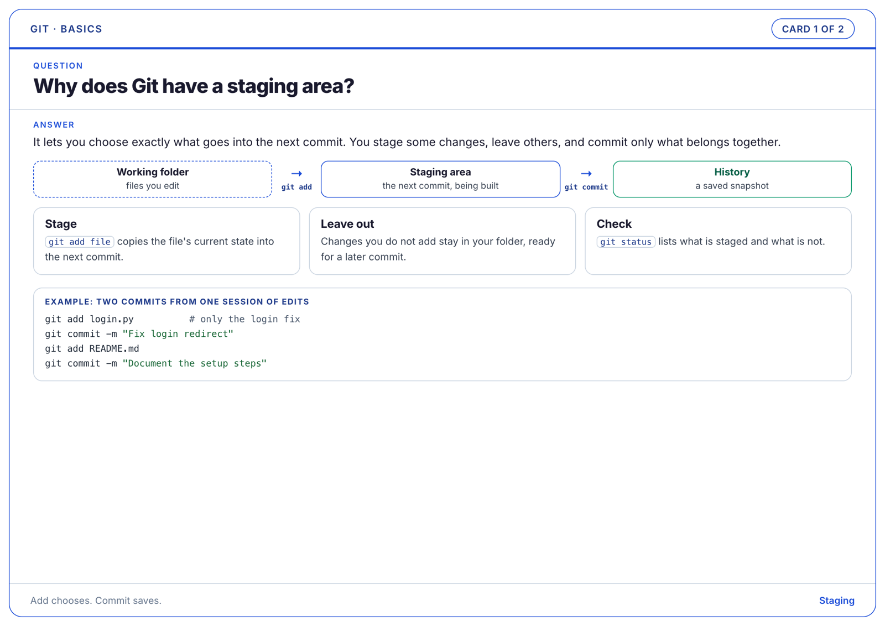
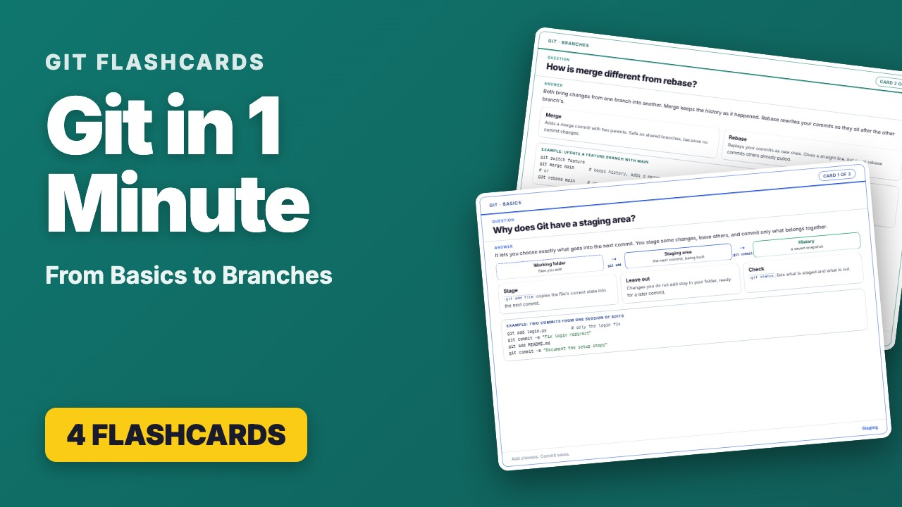
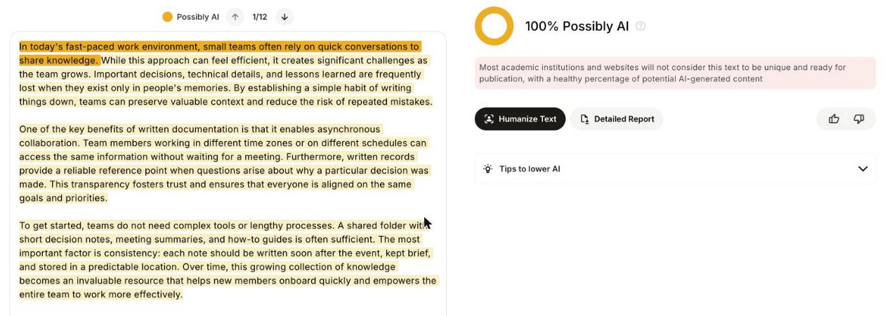
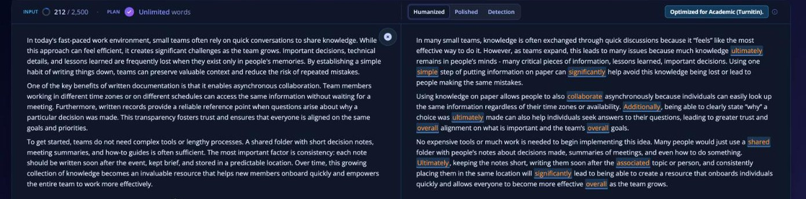
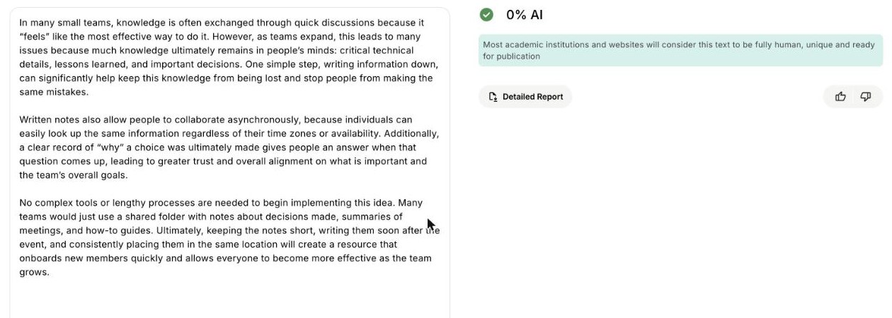

# Claude Skills

Skills for [Claude](https://claude.com), in Claude Code and the Claude app. A skill is a folder of instructions and scripts that Claude loads when a task calls for it, so it can do that task the same careful way every time.

| Skill | What it does |
| --- | --- |
| [flashcard-deck](flashcard-deck/) | Turns any subject, or material you already have (lecture PDFs, slides, notes, a repo, existing Anki cards), into print-friendly study flashcards grouped by topic, with PDFs, and optionally YouTube videos and thumbnails. It starts by asking what you need. |
| [humanize-document](humanize-document/) | Lowers a document's AI-content score below a target (50% by default) as measured by the **JustDone** AI detector, by rewriting its most-flagged paragraphs in the **Grubby** humanizer a few at a time. Claude checks every rewrite so facts, terms and formatting stay correct. Works on Word, Markdown and text files. **Needs paid Grubby and JustDone subscriptions.** |

## Install a skill

**Claude Code, as a plugin** (easiest; works in every project on your machine). Type these in Claude Code:

```
/plugin marketplace add Walid-Ahmed/claude-skills
/plugin install flashcard-deck@walid-ahmed-skills
/plugin install humanize-document@walid-ahmed-skills
```

Install only the skills you want. Restart Claude Code afterwards, then just ask for what a skill does ("make flashcards about Docker"). To get updates later: `/plugin marketplace update walid-ahmed-skills`.

**Claude Code, by copying the folder** (if you prefer plain files):

```bash
git clone https://github.com/Walid-Ahmed/claude-skills.git
mkdir -p ~/.claude/skills
cp -r claude-skills/flashcard-deck ~/.claude/skills/
cp -r claude-skills/humanize-document ~/.claude/skills/
```

Start a new Claude Code session afterwards. The skill is then listed, and you can call it by name (for example `/flashcard-deck`) or just ask for what it does. To update, pull the repo and copy the folder again.

**Claude app**: download the skill's file from [`dist/`](dist/) ([`flashcard-deck.skill`](dist/flashcard-deck.skill) or [`humanize-document.skill`](dist/humanize-document.skill)) and open it in Claude. If your account or organization allows custom skills, a **Save skill** button installs it. humanize-document works best in Claude Code, because it drives Grubby and JustDone in your Chrome and edits files on your computer.

---

## flashcard-deck

Make a deck of question-and-answer flashcards that teach the concept first, print cleanly on A4, and can become YouTube videos.

<p align="center"></p>

### What you get

- **Cards**: one A4 landscape image per card (2400 x 1698 px). The question is at the top, the answer below it: a one-line answer, then boxes, steps, tables, small diagrams, and a labelled code example. White paper with coloured outlines, so the cards are cheap to print.
- **Topics**: cards grouped into topic folders, each with its own colour, numbered "Card 2 of 5".
- **Print**: one PDF per topic and one with every card, one card per A4 page.
- **Index**: a README listing every question, and where each card comes from in your material, if you want that.
- **Videos** (optional), 1920 x 1080 with chapter descriptions ready for YouTube, in three styles:
  - question with a countdown, then the answer
  - a questions-only quiz
  - a quick review of the full cards
- **Thumbnails** (optional): a YouTube thumbnail per video.

<p align="center"></p>

### Example

**[FastAPI Flashcards: from Routes to JWT Authentication](https://www.youtube.com/watch?v=dwvtkUu2rbM&t=4s)** is a FastAPI flashcard deck in this style, made into a YouTube video.

<p align="center"><a href="https://www.youtube.com/watch?v=dwvtkUu2rbM&t=4s"></a></p>

### How to use it

Ask in your own words, in any project:

- "make flashcards about Docker basics"
- "turn my lecture slides in `slides/week3.pdf` into flashcards, with page numbers"
- "I have an Anki export of my networking cards, make them printable and grouped by topic"
- "make study cards for this repo, then a quiz video"

Claude then:

1. **Asks what you need**, with clickable choices:
   - the source of the cards
   - how closely to follow your material
   - who the cards are for
   - the maximum number of cards (the build stops if the deck grows past it)
   - which outputs you want
2. **Proposes a plan**: the topics, and the question on each card. When working from your material, it also shows which pages or sections each topic covers. Nothing is written until you approve.
3. **Builds the first topic** and shows you a few cards to check the style and depth. Then it builds the rest, checks that every card fits on its page, and fixes any that do not.
4. **Makes videos and thumbnails** only if you asked, after you approve the cards. It asks before publishing or pushing anything.

### Requirements

- Python 3 with Playwright and Pillow: `pip install playwright pillow`
- Google Chrome, or Playwright's browser: `playwright install chromium`
- For videos only, ffmpeg (`brew install ffmpeg` on a Mac)

### How it works

Claude writes the deck as one Python file, `deck.py`, using small helpers: `deck`, `topic`, `card`, `example`, and diagram helpers such as `row`, `n`, and `a`. The bundled scripts render everything from that one file, so changing a card means one edit and one rebuild. You can also run the scripts yourself:

```bash
python3 ~/.claude/skills/flashcard-deck/scripts/build_deck.py deck.py --out flashcards
python3 ~/.claude/skills/flashcard-deck/scripts/build_videos.py deck.py --cards flashcards --out videos --mode both
python3 ~/.claude/skills/flashcard-deck/scripts/build_thumbnails.py deck.py --cards flashcards --out videos/thumbnails
```

A small working deck to start from is in [`flashcard-deck/references/deck_template.py`](flashcard-deck/references/deck_template.py).

```
flashcard-deck/
  SKILL.md                      what Claude follows: interview, plan, cards, extras
  references/
    components.md               every card building block, with examples
    existing-material.md        working from your PDFs, slides, notes, or cards
    deck_template.py            a small deck to copy
  scripts/
    build_deck.py               cards, fit check, PDFs, README
    build_videos.py             YouTube videos with chapter descriptions
    build_thumbnails.py         YouTube thumbnails
    flashcards/                 the helpers, the renderer, and the card stylesheet
```

---

## humanize-document

Bring a document's AI-content score under a target, 50% by default, without changing what it says. The skill works with two third-party websites, which you use through your own accounts:

- **[Grubby](https://grubby.ai)** (grubby.ai): an AI humanizer that rewrites text so it reads less like AI output.
- **[JustDone](https://justdone.ai)** (justdone.ai): an AI-content detector that scores the text ("NN% Possibly AI") and highlights the sentences it flags.

Claude drives both sites in your own Chrome, rewrites the most-flagged paragraphs a few at a time, checks every rewrite against the original, saves it into your file, and re-scores the whole document after each batch. It stops when the JustDone score is under the target.

### It works: a real run

A three-paragraph sample note, written in a typical AI style, was run through the skill on November 14, 2026.

**Before.** JustDone flags every sentence: **100% Possibly AI**.

<p align="center"></p>

**Grubby.** The batch goes into Grubby's humanizer (Academic mode); the original is on the left, the rewrite on the right.

<p align="center"></p>

**Meaning check.** Grubby's rewrite is not used as it is. Claude compared it sentence by sentence with the original and fixed what went wrong: "help avoid this knowledge being lost or lead to people making the same mistakes" now says the opposite of the original, so it became "stop people from making the same mistakes"; "writing them soon after the associated topic or person" went back to "soon after the event"; "putting information on paper" became "writing information down"; and the dropped "technical details" was restored.

**After.** The checked text, saved into the Word file, scores **0% AI**.

<p align="center"></p>

One batch of three paragraphs was enough here. A long document takes many batches, and scores move less per batch; see "How a round works" below.

> **Subscriptions: this skill is not free to run.** Grubby and JustDone are paid services with their own plans and prices, and neither is part of Claude.
>
> - **Grubby**: the free tier has a small word allowance, so a whole document usually needs a paid plan. Even Grubby's "Unlimited" plan has a rolling daily cap (30,000 words per 24 hours in November 2026); when you hit it, the skill stops and tells you when words free up.
> - **JustDone**: every score spends AI-detector words for the whole document, so you need a paid plan or bought word packs. As a guide, a 5,000-word document scored ten times uses about 50,000 detector words. When the account runs out, the skill stops and tells you; it never buys words.
>
> Check each site's current pricing before you start. Claude never upgrades, buys, or signs in for you.

Use it on your own writing, and follow the rules on AI-assisted writing of wherever you submit it (a school, journal, publisher or employer). AI detectors are not reliable judges of authorship; this skill only changes the wording that one detector flags, with every change checked for meaning.

### How a round works

1. **Score.** Claude extracts the document's prose (no headings, code, captions or tables), uploads it to the JustDone detector, and reads the score and the share of each paragraph that is highlighted.
2. **Pick a batch.** Up to three paragraphs (250 to 600 words), most-flagged first, preferring consecutive paragraphs in one section: JustDone scores sentences in context, so finishing a section lowers the score far more than scattered edits.
3. **Humanize.** Claude pastes the batch into Grubby (Academic mode) and clicks Humanize. It asks you once, at the start, whether it may do this for every batch.
4. **Check the meaning.** Claude compares each rewritten sentence with the original and fixes only what went wrong: changed facts, numbers or scope ("every" turned into "most"), broken cross-references, synonyms for your defined terms, mangled code names, unclear phrases, and style the original avoided (contractions, emoji, a different spelling variant).
5. **Save.** For Word files, a script replaces just those paragraphs, keeps each paragraph's own style and fonts, formats code names as code, backs the file up first, and checks that nothing else changed (tables and images included).
6. **Re-score and report.** A small table of the score and each paragraph's share before and after, plus the fixes made.

At the end, Claude re-reads every rewrite of the run together, catching problems one batch cannot see (a list split across two batches, a dangling "It"), and reports the start and final scores.

### How to use it

Ask in your own words:

- "humanize `report.docx` until JustDone says it is under 50%"
- "bring the AI score of `essay.md` below 30%"
- "do three more paragraphs in Grubby"

### Requirements

- **A Grubby account** (paid plan recommended) and **a JustDone account** with detector words, both signed in in Chrome. See the subscriptions note above.
- **[Claude in Chrome](https://claude.com/chrome)**, the browser extension, connected to Claude Code. Claude uses your signed-in Chrome; it does not sign in for you.
- Python 3 with python-docx, for Word files: `pip install python-docx`
- Microsoft Word closed on the file while Claude edits it.

### What is in the folder

```
humanize-document/
  SKILL.md                         what Claude follows: batches, Grubby, meaning check, saving, scoring
  scripts/
    doc_prose.py                   list prose paragraphs, show code names, write the text to score
    replace_paragraphs.py          save rewrites into a Word file, keeping its formatting, with a backup and a run log
    grubby_fill.js                 put a batch into Grubby's editor
    grubby_read_output.js          read Grubby's Humanized or Polished output
    justdone_paragraph_shares.js   read JustDone's score and each paragraph's highlighted share
```

You can run the Python scripts yourself:

```bash
python3 ~/.claude/skills/humanize-document/scripts/doc_prose.py report.docx --list
python3 ~/.claude/skills/humanize-document/scripts/doc_prose.py report.docx --out prose.txt
```

Both websites change their pages from time to time. If a browser script stops finding things, Claude inspects the page and adjusts it.

## Building the .skill file

After changing a skill, rebuild its file for the Claude app. It is a zip of the skill folder:

```bash
cd claude-skills && rm -f dist/flashcard-deck.skill && zip -r dist/flashcard-deck.skill flashcard-deck -x '*/__pycache__/*' '*.pyc' '*.DS_Store'
```

Use the same command with another folder name, for example `humanize-document`.
